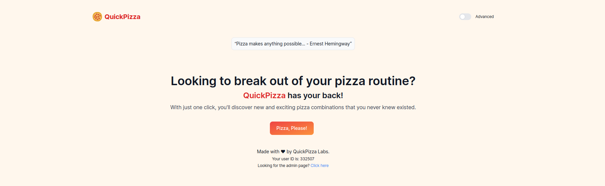
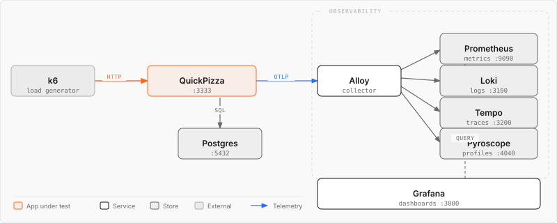

# Lab setup

In this workshop, you'll learn how to create load tests to verify the performance of QuickPizza, a simple demo application, under load.



QuickPizza is available in three environments:
- [localhost:3333](http://localhost:3333/): a local environment that runs with Docker.
- [quickpizza.grafana.com](https://quickpizza.grafana.com/): a shared test environment for small-scale load tests.
- [quickpizza.grafana.fun](https://quickpizza.grafana.fun/): a shared test environment for small-scale load tests that also lets you visualize results in [Grafana Play](https://play.grafana.org/).

## Installation steps

_**Need help?** Raise your hand and we'll come help._

Clone the repo and start QuickPizza on your local machine:

```bash
git clone https://github.com/immavalls/cnd-norway-2026-k6-workshop.git
cd cnd-norway-2026-k6-workshop
docker compose pull   # optional: the `otel-lgtm` image is over 800 MB, do this once on a good connection
docker compose up -d
```

The output should be similar to:

```bash
[+] up 7/7
✔ Network cnd-norway-2026-k6-workshop_default Created
✔ Volume cnd-norway-2026-k6-workshop_postgres_data Created
✔ Container otel-lgtm Started
✔ Container quickpizza-db Healthy
✔ Container quickpizza Started
✔ Container alloy Started
✔ Container k6 Started
```

> To reset the environment, run `docker compose down -v` to stop the containers and remove attached volumes.

QuickPizza should now be running at [localhost:3333](http://localhost:3333/). The stack also includes Grafana at [localhost:3000](http://localhost:3000/), which you'll use in later exercises.

## Choose how to run k6

You can run k6 in two ways. Pick one and use it for all the exercises:

- **k6 binary**: [install k6 OSS](https://grafana.com/docs/k6/latest/set-up/install-k6/) with your operating system's package manager. After installation, you might need to open a new terminal session so it picks up the updated `PATH`. Run `k6 version` to verify it.
- **Docker**: no installation needed. `docker compose up -d` already started a `k6` container that has this repository mounted, is connected to QuickPizza and Grafana, and publishes the k6 web dashboard on port 5665. Run k6 inside it with `docker compose exec k6 k6 ...`.

The exercises show the `k6` command. If you use Docker, add the `docker compose exec k6` prefix. The commands are the same on Linux, macOS and Windows (PowerShell or CMD).

| Exercise | k6 binary | Docker (Linux, macOS and Windows) |
|----------|-----------|-----------------------------------|
| 1, 2, 3, 4 | `k6 run k6-test.js` | `docker compose exec k6 k6 run k6-test.js` |
| 2, 3, 4: with the web dashboard | `k6 run --out web-dashboard k6-test.js` | `docker compose exec k6 k6 run --out web-dashboard k6-test.js` |
| 5: send results to Prometheus | `k6 run --out experimental-prometheus-rw 5.infrastructure-testing/sql-db-k6-test.js` (set `K6_PROMETHEUS_RW_SERVER_URL` first, see exercise 5) | `docker compose exec k6 k6 run --out experimental-prometheus-rw 5.infrastructure-testing/sql-db-k6-test.js` |

Edit the scripts on your machine with your IDE. The `k6` container sees your changes straight away.

<details>
<summary>Prefer a one-off <code>docker run</code> instead of the compose container?</summary>

Use the official `grafana/k6` image, mounting the current directory. Add `--network` with the compose network name so the container can reach QuickPizza (`docker network ls` shows it), and set `BASE_URL`:

```bash
# Linux and macOS
docker run --rm -u $(id -u) -v $PWD:/app -w /app \
  --network cnd-norway-2026-k6-workshop_default -e BASE_URL=http://quickpizza:3333 \
  grafana/k6 run k6-test.js
```

```powershell
# Windows (PowerShell)
docker run --rm -i -v ${PWD}:/app -w /app `
  --network cnd-norway-2026-k6-workshop_default -e BASE_URL=http://quickpizza:3333 `
  grafana/k6 run k6-test.js
```

The `docker compose exec` approach is simpler, so we recommend it for this workshop.

</details>

Next, run a basic k6 test to verify your installation and test environment:

```bash
k6 run k6-test.js
```

<details>
<summary>Alternative: run the test against a remote testing environment</summary>

```bash
k6 run -e BASE_URL=https://quickpizza.grafana.com k6-test.js
```

With Docker, add the prefix: `docker compose exec k6 k6 run -e BASE_URL=https://quickpizza.grafana.com k6-test.js`

</details>

The output should look similar to:

```bash
...
running (00m00.1s), 0/1 VUs, 1 complete and 0 interrupted iterations
default ✓ [======================================] 1 VUs  00m00.1s/10m0s  1/1 iters, 1 per VU
```

You'll continue building on this k6 script in the next exercises.

## Related Resources

The following diagram shows the Docker Compose architecture used in this workshop:



- [k6 OSS documentation](https://grafana.com/docs/k6/latest/)
- [github.com/grafana/quickpizza](https://github.com/grafana/quickpizza): This repository can be used to learn and explore the Grafana observability stack.

---

[Workshop homepage](https://github.com/immavalls/cnd-norway-2026-k6-workshop) · [Next exercise →](../2.basic-load-test/)